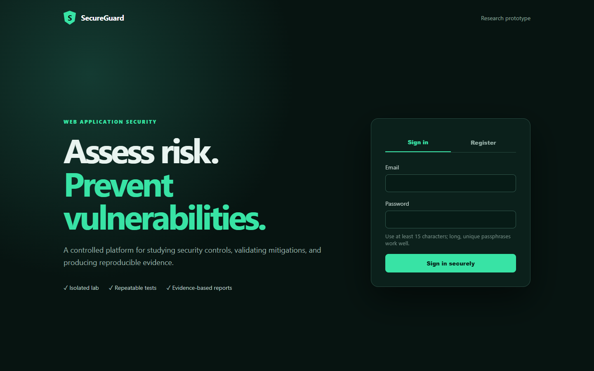
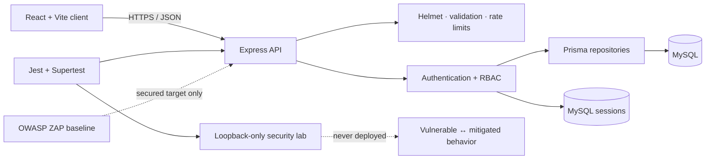

# SecureGuard

**A Security Assessment and Vulnerability Prevention Platform for Web Applications**

SecureGuard is an academic full-stack research prototype for demonstrating, mitigating, and evaluating common web application vulnerabilities in a controlled environment. It combines a secured React/Express application, session-based authentication, an isolated vulnerability laboratory, and repeatable security comparisons.

> **Safety:** vulnerable routes are disabled by default, bind only to loopback, and must never be deployed publicly or aimed at third-party systems.

## Current scope

- React 19 and Vite frontend
- Express 5 API with Helmet, CORS, request-size limits, validation, and centralized error handling
- MySQL data model through Prisma
- Registration, login, logout, bcrypt password hashing, rotating sessions, secure cookies, user/admin RBAC, and login throttling
- Local demonstrations of SQL injection, reflected XSS, broken access control, weak sessions, and brute-force exposure
- Jest/Supertest application, mitigation, and comparison suites
- Machine-readable Jest results and an assessment report generator
- Docker Compose, OWASP ZAP baseline configuration, and GitHub Actions CI

This is a research foundation, not a production vulnerability scanner. It does not crawl or attack external targets.

## Interface preview

### Desktop sign-in



### Desktop registration


### Responsive mobile view


### Automated test evidence


### Security assessment evidence


## Architecture



## Repository layout

```text
SecureGuard/
├── frontend/             React/Vite interface
├── backend/              Express API, Prisma schema, auth, tests
├── security-lab/         disabled-by-default local demonstrations
├── security-tests/       comparative tests, ZAP policy, report generator
├── security-results/     generated machine-readable evidence (ignored)
├── research/             academic report and release review
├── docs/                 supporting security documentation and screenshots
├── scripts/              local ZAP runner
├── .github/workflows/    CI checks
├── docker-compose.yml    MySQL, API, and web containers
└── .env.example          non-secret configuration template
```

## Local installation

### Prerequisites

- Node.js 20 or newer (verified with 22.14.0)
- npm 10 or newer
- MySQL 8, or Docker with Compose

```bash
git clone <your-repository-url>
cd SecureGuard
npm install
cp .env.example .env
```

Edit `.env`. Generate independent high-entropy values for `SESSION_SECRET`, `MYSQL_PASSWORD`, and `MYSQL_ROOT_PASSWORD`; never commit `.env`.

### With local MySQL

```bash
npm run prisma:generate
npm run prisma:migrate -w backend -- --name init
npm run dev
```

Open `http://localhost:5173`. The health endpoint is `http://localhost:3000/api/health`.

### With Docker Compose

```bash
docker compose up --build
```

The web application is bound to `127.0.0.1:8080` and the API to `127.0.0.1:3000`. Compose requires password variables in `.env`. Docker was not available in the latest recorded verification environment, so these container commands and the ZAP container scan remain to be executed on a Docker-capable host.

## Testing and quality checks

```bash
npm test
npm run lint
npm run format:check
npm run build
```

The latest local run passed 22/22 tests and the production build. Generate the structured report after the security suite:

```bash
npm run test -w security-tests
npm run report -w security-tests
```

Machine-readable results are written to `security-results/jest-results.json`. Generated results are intentionally ignored so evidence from one machine is not mistaken for universal results.

### OWASP ZAP baseline

Start only the secured API, then run on a Docker-capable machine:

```powershell
./scripts/run-zap-baseline.ps1 -Target http://host.docker.internal:3000
```

Review every alert manually. Do not scan the vulnerable lab or any system you do not own and have permission to test.

## Authentication security decisions

- bcrypt cost 12 makes offline guessing more expensive; plaintext passwords are never stored.
- Registration accepts 15–128 character passphrases and rejects a small starter blocklist. A production deployment should use a maintained compromised-password blocklist without leaking the password to third parties.
- Login errors are generic, and a dummy bcrypt comparison reduces account-enumeration timing differences.
- Session IDs rotate after authentication to prevent fixation. Production sessions are stored in MySQL, not the default in-memory store.
- Cookies are `HttpOnly`, `SameSite=Lax`, one-hour rolling expiry, and `Secure` in production.
- Authorization is deny-by-default middleware with explicit `USER` and `ADMIN` roles.
- Failed login attempts are rate-limited; successful attempts do not consume the limit.

## Security limitations

- CSRF tokens are not yet implemented; `SameSite=Lax` is useful defense in depth but is not a complete CSRF strategy.
- Email verification, MFA, account recovery, audit logging, session-device management, and account-level adaptive throttling are future work.
- The starter password blocklist is deliberately small.
- The in-process rate limiter requires a shared store before horizontally scaled deployment.
- Automated tests prove only enumerated behaviors; they do not establish that the application is vulnerability-free.
- Six low-severity development-tool advisories remain in Jest's `deepmerge` chain as reported by npm audit; they are not loaded by the production application. Track upstream remediation before release upgrades.
- No Docker/ZAP results are claimed in this environment.

## Research documentation

- [Final research report](research/final-report.md)
- [Controlled lab guide](security-lab/README.md)
- [Threat model](docs/threat-model.md)
- [Final release review](research/release-review.md)

## Responsible use

Use SecureGuard only in isolated, authorized environments. Never target third-party services, use real credentials in demonstrations, or publish the vulnerable components.

## License

[MIT](LICENSE)
