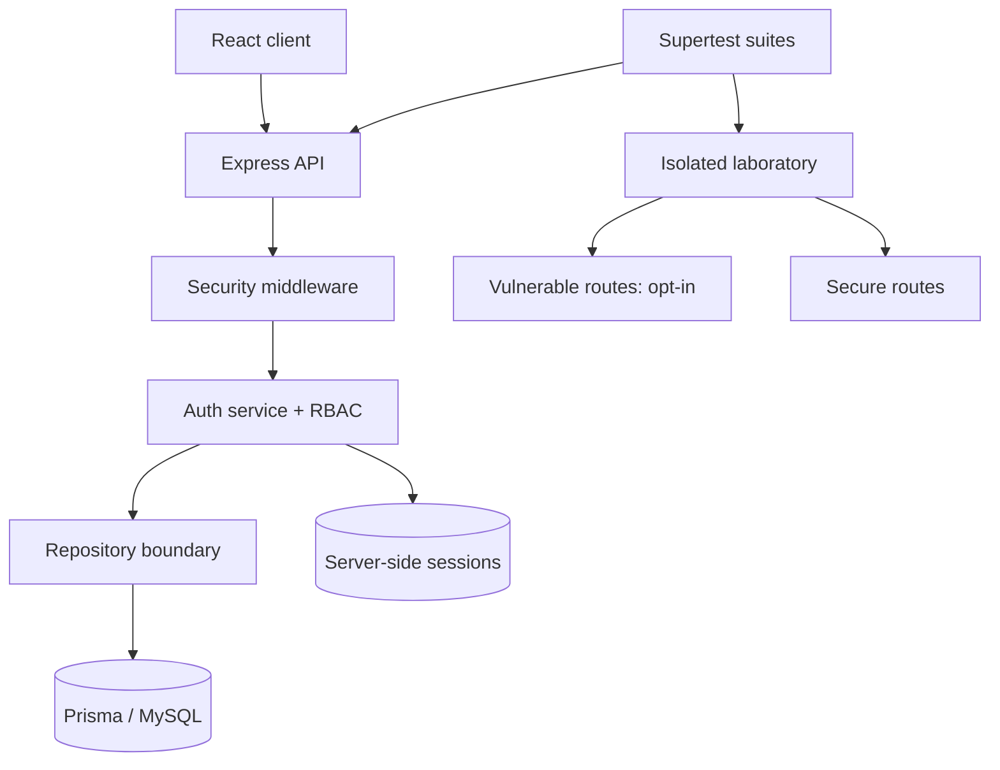

# SecureGuard: A Controlled Platform for Web Application Security Assessment and Vulnerability Prevention

## Abstract

SecureGuard is a reproducible academic prototype that joins a secured web application, a deliberately isolated vulnerability laboratory, and automated comparison tests. It examines five common weakness classes: SQL injection, reflected cross-site scripting, broken access control, weak session configuration, and brute-force login exposure. The implemented application uses React, Express, MySQL through Prisma, bcrypt password hashing, server-side sessions, role-based authorization, validation, security headers, and rate limiting. In the recorded local experiment, all 22 application and security tests passed; the dedicated comparative suite passed 6 of 6 tests and demonstrated mitigation behavior for all five modeled weakness classes. These findings are limited to the specified test cases and are not evidence that the system is free of vulnerabilities. Docker and OWASP ZAP were unavailable in the experiment host, so no dynamic scan findings are reported.

## 1. Introduction and motivation

Web application security education often separates vulnerable examples, secure engineering, and evaluation. That separation makes it difficult to demonstrate that the same input which triggers a weakness is neutralized by a specific control. SecureGuard instead places the vulnerable and mitigated behaviors in an intentionally small comparison framework. The design emphasizes reproducibility, explicit safety boundaries, and claims tied to machine-readable test evidence.

The intended audience is university lecturers, cybersecurity researchers, and Erasmus Mundus evaluators. SecureGuard is an implementation and teaching artifact, not a public attack service or commercial scanner.

## 2. Problem statement

Students need a safe method to reproduce important web weaknesses, inspect their causes, implement mitigations, and evaluate those mitigations without interacting with third-party targets. Existing demonstrations can also create accidental exposure when insecure routes are deployed with ordinary application components. The research problem is therefore: how can a compact full-stack platform make vulnerable-versus-secure comparisons repeatable while enforcing strong isolation and evidence discipline?

## 3. Research objectives

1. Implement a modular web application with defensible authentication and least-privilege authorization.
2. Model five weakness classes in a localhost-only laboratory that is disabled by default.
3. Apply secure alternatives and prove their expected behavior with automated tests.
4. Export machine-readable results and distinguish measured facts from assumptions.
5. Document the architecture, threat model, methodology, limitations, and reproduction procedure.

## 4. Related work

The [OWASP Top 10:2021](https://top10.owasp.org/2021/) is an awareness taxonomy of significant web application risks. SecureGuard's access-control, injection, and authentication exercises correspond particularly to A01, A03, and A07. The taxonomy guides topic selection but is not used as a certification standard.

The [OWASP Application Security Verification Standard 5.0](https://asvs.owasp.org/) provides testable requirements for designing and verifying web application controls. SecureGuard adopts its general verification-oriented approach: each mitigation is linked to an executable check. Full ASVS coverage is outside this prototype's scope.

The [NIST Digital Identity Guidelines, SP 800-63B-4](https://pages.nist.gov/800-63-4/sp800-63b.html) recommend salted password hashing, compromised-password blocklisting, and rate limiting for centrally verified passwords. SecureGuard uses bcrypt, enforces a 15-character minimum, includes a small local starter blocklist, and throttles failed login attempts. A production-quality compromised-password corpus is future work.

[OWASP ZAP](https://www.zaproxy.org/docs/docker/baseline-scan/) supplies a containerized passive baseline scan suitable for CI against a running secured target. SecureGuard includes baseline configuration and a runner, but the scan was not executed because Docker was absent from the experiment host.

## 5. System architecture

The monorepo contains four executable workspaces. The React/Vite frontend communicates with an Express JSON API. The API applies Helmet, CORS, size limits, input validation, sessions, authentication, and authorization before repositories access MySQL through Prisma. Production sessions are persisted in MySQL. Tests inject an in-memory user repository and session store so authentication behavior is deterministic and does not depend on an external database.



## 6. Threat model

Protected assets include password verifiers, session identifiers, roles, user data, and service availability. Principal adversaries are unauthenticated remote callers, authenticated normal users attempting privilege escalation, and attackers with captured session identifiers. Trust boundaries exist between browser and API, API and database, and developer workstation and laboratory. The complete STRIDE analysis is in [`docs/threat-model.md`](../docs/threat-model.md).

The laboratory uses synthetic records and has two independent isolation controls: vulnerable routes require `ENABLE_VULNERABLE_LAB=true`, and the standalone server rejects all non-loopback bind addresses. These reduce accidental exposure but do not make the vulnerable code suitable for deployment.

## 7. Security methodology

Authentication normalizes email addresses, validates request shape, hashes passwords with bcrypt cost 12, and performs a dummy hash comparison for unknown accounts to reduce a timing enumeration signal. Error messages do not distinguish unknown accounts from wrong passwords. Successful registration and login regenerate the session identifier, addressing fixation. Logout destroys server-side state and clears the cookie.

Session cookies are `HttpOnly`, `SameSite=Lax`, limited to one hour with rolling renewal, and `Secure` in production. MySQL-backed storage avoids Express's unsuitable production memory store. Authorization middleware checks authentication before evaluating roles and exposes only explicit user and administrator routes. This provides a small deny-by-default policy surface.

Helmet supplies baseline headers, JSON bodies are limited to 16 KiB, Zod rejects malformed credential requests, and errors are translated to stable public codes without exposing stack traces. The controls were selected because each addresses a threat represented in the model and can be verified independently.

## 8. Vulnerability assessment methodology

Each comparative test follows two steps: confirm that the opt-in laboratory exhibits the modeled weakness, then send the same relevant input to the secured alternative and assert neutralization or rejection. SQL injection uses an authentication-bypass string; XSS uses an event-handler HTML payload; access control requests another owner's record; session checks inspect cookie attributes and predictability; rate-limit checks compare repeated login behavior.

Jest produces JSON output at `security-results/jest-results.json`. `security-tests/src/generate-report.js` derives counts and pass rate from that file. Response-time exploration executes 20 in-process Supertest requests against each XSS endpoint and reports the difference between arithmetic means. No threshold is asserted because host scheduling, JIT warm-up, and instrumentation dominate such a small sample.

False-positive rate is not measurable from this curated five-case corpus: it contains no independently labeled benign/adversarial dataset. A passing comparison is evidence for the exact assertion only.

## 9. Experimental setup

- Date: 5 November 2026
- Host operating system: Windows 10 family (`Windows_NT 10.0.26200`)
- Node.js: 22.14.0
- npm: 10.9.2
- Jest: 29.7.0
- Supertest: 7.1.4
- Prisma: 6.12.0
- Vite: 7.3.7
- Execution target: in-process Express applications using Supertest
- External targets and real personal data: none
- Docker/ZAP: not executed; Docker command unavailable

Reproduction commands are:

```bash
npm install
npm test
npm run lint
npm run build
npm run report -w security-tests
```

The vulnerable server must not be started for the automated comparison; tests construct it in process. Manual reproduction instructions are in [`security-lab/README.md`](../security-lab/README.md).

## 10. Evaluation and results

The recorded run produced the following actual results:

| Test group                       | Passed |  Total | Pass rate |
| -------------------------------- | -----: | -----: | --------: |
| Authentication and authorization |     10 |     10 |      100% |
| Laboratory mitigation tests      |      6 |      6 |      100% |
| Comparative security assessment  |      6 |      6 |      100% |
| **All automated tests**          | **22** | **22** |  **100%** |

The comparative suite first detected the modeled vulnerable behavior in five classes and then verified the corresponding mitigation in all five. Thus, within this deliberately bounded suite: vulnerabilities modeled = 5; vulnerable behaviors detected = 5; mitigations passing = 5. This does not estimate real-world vulnerability prevalence.

For the 20-iteration XSS endpoint timing probe, the vulnerable mean was 3.150 ms, the secured mean was 3.499 ms, and the observed difference was 0.349 ms per request. The sample is too small and uncontrolled for statistical inference; it only confirms that timing collection works. Lint and the frontend/Prisma production build passed.

No ZAP alerts, false-positive counts, container health results, or database integration results are reported because the required Docker runtime was not installed. npm audit reported six low-severity advisories in Jest's development-only `deepmerge` chain after non-breaking fixes; no high or critical advisories remained.

## 11. Limitations

The SQL injection exercise is a behavioral simulation of unsafe query construction rather than a destructive query against a real database. This improves safety but reduces ecological validity. The XSS check verifies encoding and headers but does not execute a browser payload. Tests use in-memory adapters and therefore do not validate MySQL failure modes, migrations, or transaction behavior. Rate limiting is process-local; distributed deployments need a shared counter store. CSRF tokens, MFA, email verification, secure recovery, structured audit logging, and session inventory are not implemented. The password blocklist is insufficient for production. Dependency and dynamic scanning are incomplete, and the timing observation is not a benchmark.

## 12. Future research directions

Future work should add a Docker-capable reproducibility environment, MySQL integration tests, ZAP and dependency-scan baselines with manual triage, browser-driven CSP/XSS tests, CSRF tokens, WebAuthn-based MFA, distributed rate limiting, immutable security audit events, and property-based input generation. A labeled benign/adversarial corpus would permit precision, recall, and false-positive measurement. Repeated randomized timing trials with confidence intervals could quantify control overhead responsibly.

## 13. Implementation versus research contribution

Implementation work includes the monorepo, authentication module, laboratory, middleware, tests, Docker definitions, and CI. The research contribution is narrower: a safety-gated comparison method that binds five modeled weaknesses to repeatable vulnerable-versus-mitigated assertions and machine-readable evidence. The project does not claim a novel vulnerability-detection algorithm.

## 14. Conclusion

SecureGuard demonstrates that a compact full-stack system can integrate secure engineering, controlled vulnerability education, and evidence-based evaluation. The recorded automated checks support the expected behavior of the implemented controls for the exact tested cases. Remaining work—particularly CSRF protection, production account lifecycle features, MySQL integration, Docker verification, and ZAP triage—must be completed before describing the system as production-ready.
